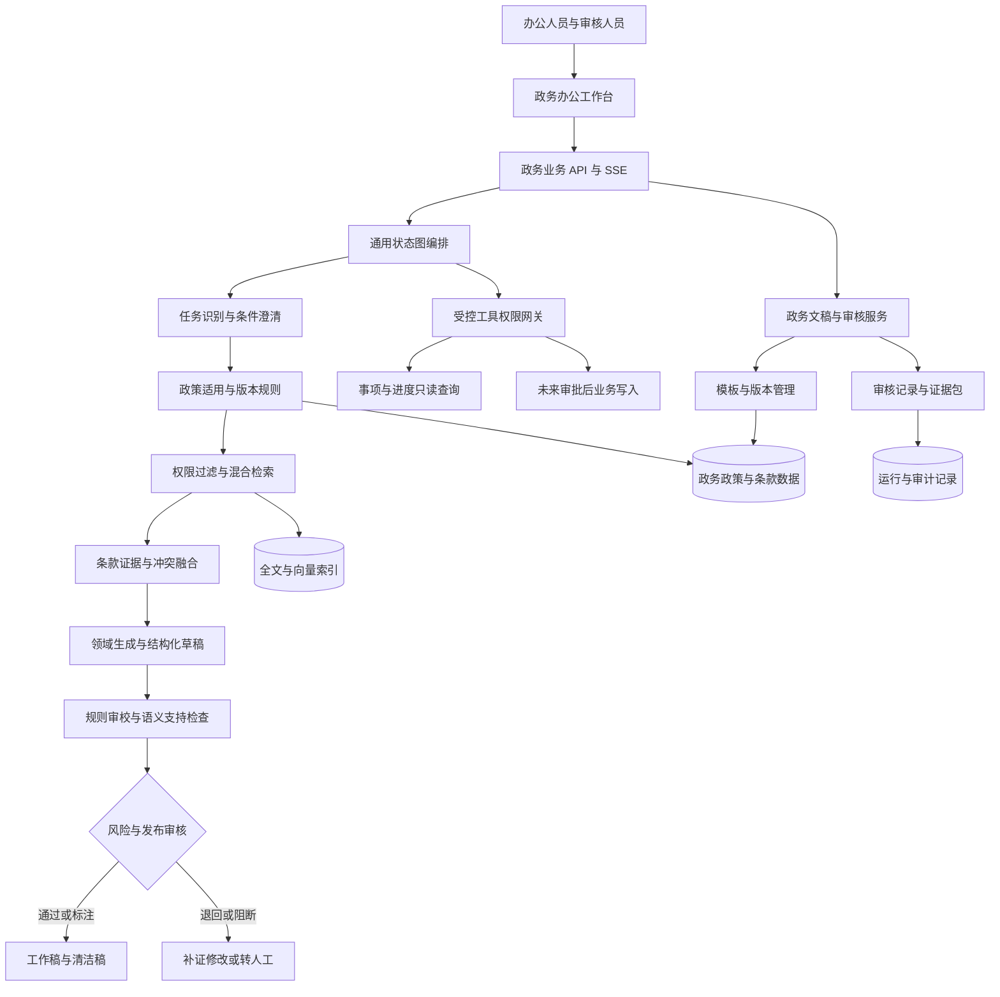
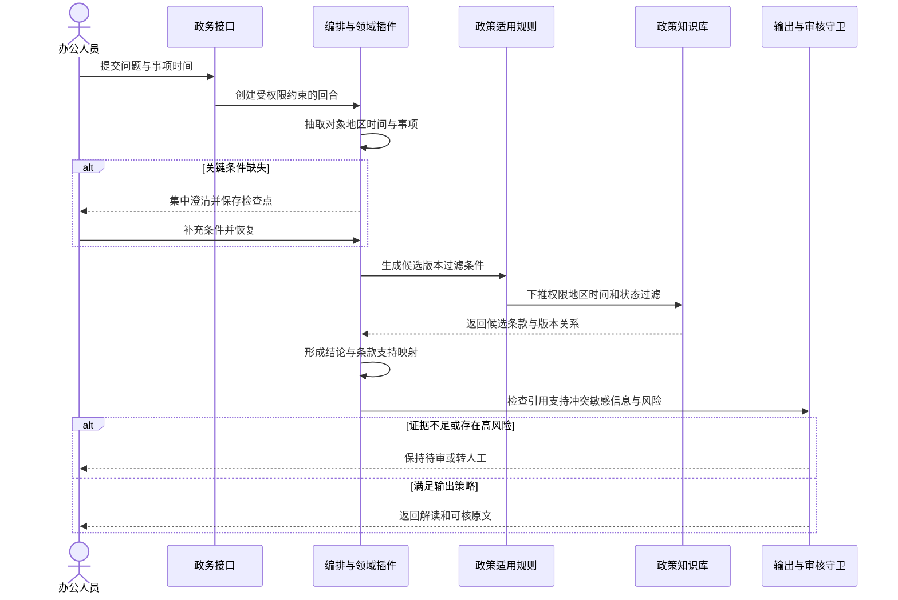

# 可信政务办公智能体技术方案

> 文档版本：v1.0（目标设计基线）  
> 编制日期：2026-10-27  
> 对应产品：同目录《01-产品方案》  
> 实现状态：目标设计基线。2026-10-27 已完成 G-04～G-22、G-24：政策/会话/文稿/公文/咨询、`/gov` 工作台、审核审计、DOCX 与部署说明；2026-10-28 增补 G-25 金标草案（27 条）与 G-26 首轮校准（完整方案 27/27、朴素检索 4/15）。真实模型选型（G-23）、独立人工复核和试点仍待验证，实际进度以 `TASKS.md` 为准  
> 建设约束：复用 AngentPlatform，不重写通用底座；当前无试点单位，不虚构真实数据、性能、准确率与部署成效

---

## 一、建设目标与技术边界

### 1.1 建设目标

本方案为政策解读、公文起草、文稿撰写、提炼总结和政务咨询发布辅助提供统一技术设计，并为未来对话式政务办理插件保留受控工具接口。技术目标是让系统回答和文稿具备可核验的来源、可解释的适用判断、可复跑的评测以及可追踪的审核责任，而不是单纯提升文本流畅度。

核心技术问题包括：

1. 如何把政策文件、版本、条款和效力关系转化为可计算、可审核的知识对象；
2. 如何在生成前完成地区、对象、时间和权限约束，避免检索到错误版本；
3. 如何验证自然语言结论确实受到条款支持，而非只检查引用编号存在；
4. 如何把公文硬规范、事实一致性和语言风格拆成不同审校机制；
5. 如何让模型、知识、模板、规则和工具的变化可版本化、可回滚、可审计；
6. 如何在没有试点单位的阶段形成可信的公开样本验证，再平滑进入真实试用。

### 1.2 技术原则

- **通用机制下沉，政务语义入插件。** 通用知识、编排、权限和审计继续由平台承担；政策、模板和文稿规则进入 `gov_office` 领域包及政务业务域。
- **确定性判断优先。** 日期比较、效力状态、权限、格式硬规则、数字一致性、审批和幂等由规则与事务控制，不让模型裁决。
- **检索前置过滤。** 权限、地区、知识状态和适用时间尽可能下推存储层，不能先取出无权或无效材料再在提示词中忽略。
- **生成与审核分离。** 模型可提出候选文本和语义审校意见，但不能批准自己的输出，也不能绕过人工审核和输出规则。
- **证据与正文分离。** 工作稿保留证据映射，清洁稿按文种要求呈现；导出清洁稿不删除归档的证据包。
- **所有新增能力分期验收。** 文件、字段、接口和指标在代码与测试出现前均为目标，不在申报材料中写成既有成果。

### 1.3 非目标

首期不训练基础大模型，不建设全量政务数据中台，不替代机关既有办公和业务系统，不实现自动行政决定、自动签发、自动用印和未经审核的公开发布。对话式政务办理仅设计渐进接口，真实写入必须另立安全与业务验收批次。

---

## 二、现有平台复用基线

### 2.1 已有能力与复用方式

| 平台已有能力 | 政务场景复用 | 不能直接替代的新增能力 |
|---|---|---|
| KP-1 知识管道与混合检索 | 政策解析、切分、引用映射、权限检索和证据召回 | 政策版本、条款层级、效力关系与适用时间计算 |
| 信息分级与冲突保留 | 区分原文、内部材料、用户陈述和模型推断，展示冲突 | 政策权威层级和新旧关系的专门裁决规则 |
| 状态图编排与中断恢复 | 条件澄清、规划、检索、生成、自检和人工等待 | 四类办公任务的领域输入、模式路由与专用审校节点 |
| 领域插件与类型化钩子 | 注册政务生成、评估、工具和持久化能力 | 政务领域包、政策规则、模板包与评测器 |
| 输出守卫与人工审核 | 引用检查、敏感提示、低置信分流、审核前停发 | 条款支持性、数字事实核对、公文规范与公开发布规则 |
| 工具权限网关与 MCP | 未来事项查询、进度查询和受控业务连接 | 事项目录适配、表单映射、写入对账和业务授权 |
| 评估、审计与运行记录 | 领域评分、版本留痕、追踪与复跑 | 政务金标集、专用维度、公开样本报告和成效测试 |
| 模型网关与离线通道 | 可替换模型、超时熔断、确定性机制演示 | 真实模型选型、中文政务质量评测与私有化适配 |

平台当前引用存在性检查不等于语义支持性检查。政务实现必须保留这一事实，不能因正文出现引用角标就宣称无幻觉。现有离线通道可用于确定性回归，但其规则组装文本不能代表真实大模型的政务写作质量。

### 2.2 代码与文档边界

现有通用代码位于 `platform/core/`，业务入口位于 `platform/app/`，领域包位于 `platform/domains/`，前端位于 `platform-web/`。政务实现遵循现有应用工厂、业务域分层、服务门面、请求级 Session、统一响应和迁移规范。

目标新增范围建议如下，具体以实施时最新源码复核为准：

```text
platform/
├── app/gov_office/                 # 政务业务入口、服务、模型与契约
├── domains/gov_office/             # 领域配置、提示词、规则、工具与评估
│   ├── domain.yaml
│   ├── hooks.py
│   ├── prompts/
│   ├── policy/
│   ├── document/
│   ├── consultation/
│   ├── tools/
│   └── evaluation/
├── adapters/                       # 仅放通用存储、模型或协议适配扩展
└── tests/gov_office/               # 单元、契约、集成与验收测试
```

`app/gov_office` 负责文稿、审核、知识和评测等业务持久化及接口；`domains/gov_office` 负责智能体语义与可装配规则。跨域访问经服务门面，不在政务域直接操作其他业务域的表。政策专用判断不得散落到通用编排引擎。

---

## 三、总体技术架构

### 3.1 逻辑架构



### 3.2 四层职责

**交互层**提供政策解读、文稿工作区、条款对照、审核中心、咨询拟稿、知识管理和评测中心。正文、证据与审校意见使用稳定标识关联，避免仅按文本位置脆弱匹配。

**业务层**负责政策与模板发布、文稿版本、审核任务、咨询答复和评测报告。所有写接口使用明确契约与幂等机制，审核决定绑定对象摘要，对象修改后旧审核自动失效。

**智能体层**复用澄清、规划、检索、融合、工具、评估、生成和输出流程，通过领域钩子注入政策适用、文稿组装、专用工具计划和评估对象。高风险场景在正文输出前中断，恢复时重新校验权限、审核和对象版本。

**数据与集成层**保存政策原文、版本、条款、关系、模板、草稿、证据和评测数据；模型经统一网关接入，外部工具经白名单和权限网关接入。原始文件、正文索引和向量数据使用一致的知识标识与版本，支持下架和删除传播。

### 3.3 一次政策解读的处理时序



该时序中的「适用规则」先于文本生成，避免模型先在错误政策上形成流畅答案，再尝试用后处理补救。

## 四、政策知识治理与精准检索

### 4.1 政策数据模型

政策知识不能只保存切块文本和向量。目标模型至少区分文件、版本、条款和关系四类实体，并保留来源与审核信息。

| 对象 | 关键字段 | 设计目的 |
|---|---|---|
| 政策文件 | 文件标识、标题、发文字号、发文机关、政策类型、权威来源 | 确定文件身份，避免同名文件混淆 |
| 政策版本 | 版本号、成文日期、发布日期、施行日期、失效日期、原文哈希、解析版本 | 固定某次修订内容和时间边界 |
| 政策条款 | 章条路径、条款序号、原文、结构化条件、例外、引用定位 | 支持条款级检索、引用和适用判断 |
| 政策关系 | 修订、废止、替代、引用、补充、上位依据、关系依据 | 表达明确关系，不让模型猜测新旧效力 |
| 来源登记 | 来源类型、来源地址、获取时间、发布主体、可信等级、审核人 | 证明出处并支持来源治理 |
| 知识状态 | 草稿、待审、已发布、已下架、失败原因 | 控制知识是否允许进入正式检索 |

知识审核状态与政策法律效力是正交概念。「已发布」只表示平台审核通过，不表示政策仍然有效；「已废止」政策仍可保留用于历史事项查询，但默认不进入当前咨询候选。

日期字段按法律和业务含义分别建模，不能用一个「发布时间」替代全部时间。对只有年度、月份或缺失日期的文件，保留精度与未知状态，不擅自补成某月一日。涉及日期时间的运行日志统一使用带时区时间，政策本身的成文、施行和失效日期按日期语义处理。

### 4.2 条款结构化和人工校正

解析器先识别标题、发文字号、发文机关、日期、章、节、条、款、项和附件，再形成稳定条款标识。附件中的表格、条件和材料清单需要保留行列关系，不能拆成失去上下文的短句。

模型可以辅助抽取适用对象、条件、禁止项和办理要素，但抽取结果必须带原文定位和置信状态。用于确定性判断的结构化字段须经规则校验，关键字段由人工确认；模型未确认的抽取只能用于检索增强，不能直接决定资格或效力。

扫描件和图片型 PDF 的 OCR 属于独立适配任务。OCR 结果保留页码、坐标和识别质量，低质量页进入人工校正；未校正内容不得成为高风险结论的唯一依据。

### 4.3 效力与版本选择规则

政策适用计算以可解释规则执行，基本输入包括查询时间、地区、主体、事项和查询目的。基本过程为：

1. 按当前用户权限和知识发布状态过滤；
2. 按发文机关辖区、适用地区和事项范围筛选候选文件；
3. 按查询目的确定时间语义，历史事项使用事项发生时间，当前咨询使用当前日期；
4. 根据施行、失效和修订关系确定候选版本，单独保留尚未施行与历史有效版本；
5. 根据明确的上位依据、特别规定和例外关系提示适用顺序；
6. 无法由已审核关系确定时，返回冲突或待确认，不由模型自行宣布谁优先。

「新法优于旧法」「上位优于下位」等原则不能简化成无条件排序。不同制定机关、适用范围、特别授权和过渡期均可能改变判断，系统只能执行已经建模和审核的规则，复杂争议转人工。

### 4.4 检索与排序

查询构造同时保留语义问题、发文字号、标题别名、主体、地区、时间和条款关键词。发文字号等精确标识优先精确匹配，语义检索负责发现相关条款，元数据过滤负责限制范围。

现有平台的向量与全文加权可作为初始技术基线，但政务权重不能未经验证固定照搬。应在政务开发集上比较精确检索、全文、向量和混合排序，再在独立测试集报告结果。权限、知识状态和硬性元数据不参与模型打分，而是在召回前后以确定性条件约束。

候选结果至少包含文件、版本、条款路径、原文、效力信息、来源和权限信息。上下文组装按条款完整性控制长度，避免把条件与例外分到不同窗口。必要时保留章标题、条款上级和相邻例外，但不能无边界拼接整份文件。

### 4.5 冲突与更新

冲突检测至少覆盖版本冲突、地区口径冲突、材料与政策冲突、数字事实冲突和用户陈述与授权材料冲突。冲突双方分别保留证据和适用范围，输出不支持只取一方作为默认答案。

政策更新采用新版本入库而非覆盖旧版本。新解析或修订使派生条款、摘要、向量、案例和待审文稿进入重新校验流程；已经产生的历史回答保留当时的知识与模型版本，不能后台改写历史记录后仍称原回答。

---

## 五、可追溯生成与公文技术

### 5.1 统一论断证据模型

政策解读、正文事实、摘要要点和咨询答复统一使用论断与证据映射。目标结构包含：

```text
claim_id             稳定论断标识
claim_text           待检查的事实、判断或要求
claim_type           政策结论、事实、数字、引语、建议或表达
source_refs          来源文件、版本、条款或材料位置
support_status       支持、矛盾、不足、未检查
support_method       确定性规则、人工、模型辅助或组合
review_state         无需审核、待审、通过、退回
```

引用编号存在只通过结构校验。语义支持检查进一步判断引用是否覆盖主体、条件、时间、否定词和数量单位。数字、日期、名单和条款编号优先用规则核对；自然语言支持关系可由受控模型辅助，输出支持、矛盾或不足以及具体定位，模型失败时高风险论断保持待审。

工作稿中的模型建议与事实论断分开。写作建议可以没有外部事实证据，但不得伪装成政策要求或既有工作成果。

### 5.2 四类任务共用生成骨架

不同任务共享「任务理解—必要澄清—证据装配—结构化草稿—自检—审校—输出」骨架，通过模式配置选择输入槽位、模板、必需证据、审校规则和输出结构。

政策解读生成条款型草稿；公文起草生成文种型草稿；文稿撰写先生成可确认提纲，再分段成稿；提炼总结先建立段落覆盖清单，再生成摘要与任务列表；咨询拟稿使用同一证据生成公众可读版本，但保留内部审核视图。

生成提示词只承载角色、任务和表达约束，不把权限、版本和格式硬规则寄希望于模型自觉遵守。规则结果以结构化上下文输入，输出也先转换为结构化草稿，再进入通用输出守卫。

### 5.3 公文模板系统

模板由模板标识、适用文种、地区或单位范围、版本、结构定义、必填要素、样式定义、规则集和审核记录组成。模板依据《党政机关公文处理工作条例》、GB/T 9704 及实际单位规范配置，实施时核对适用版本，不在代码中散落样式常量。

模板分为三层：

1. **结构层**：标题、主送、正文、附件说明、落款等文种要素及顺序；
2. **内容层**：不同文种所需背景、依据、事项、请求或要求，以及禁止混用的行文关系；
3. **版式层**：页面、字体、字号、行距、编号和附件等导出设置。

结构缺失和明确格式错误由规则判定；内容是否得体、措施是否符合材料由语义审校和人工判断。模板不能覆盖法律效力和事实审核，也不能因为版式正确就给出内容合格结论。

### 5.4 起草与事实约束

起草服务先构建事实清单，字段包括事实内容、来源、允许用途、敏感级别和核对状态。模型只获得当前任务有权使用的事实与政策证据，生成后将正文中的数字、日期、对象、引语和工作举措与清单比对。

对缺失事实，系统返回结构化补充项，不用「某某」「若干」等措辞悄悄掩盖，也不在正式成稿中保留大量无处理占位。确需用户后续填写的内容在工作稿明确标识，并在清洁稿导出前再次检查。

历史公文只作为经授权的结构与表达参考，不自动成为当前事实。用户上传材料属于当事方提供材料，权威等级与政策原文不同；两者冲突时显示差异并等待核实。

### 5.5 分层审校

| 审校层 | 典型检查 | 执行方式 | 失败处理 |
|---|---|---|---|
| 结构规则 | 文种要素、顺序、必填项、编号和模板约束 | 确定性规则 | 定位并阻止清洁稿导出 |
| 事实规则 | 数字、日期、对象、引语、附件和材料一致性 | 规则加结构化比对 | 标记错误，要求补证或修改 |
| 政策规则 | 依据版本、条款适用、冲突和失效状态 | 政策规则引擎 | 退回、换据或转人工 |
| 语义审校 | 跑题、遗漏、过度承诺、语气与逻辑 | 模型辅助加规则 | 给出建议，高风险进入审核 |
| 安全审校 | 敏感信息、越权内容、提示注入和公开风险 | 安全 Hook 与发布规则 | 脱敏、阻断或转人工 |

审校结果包含规则或模型版本、严重级别、问题位置、理由、证据和处理状态。用户处理后发现新问题可重新审校，正文摘要变化使原审核决定失效。

### 5.6 提炼总结与咨询生成

长文总结先建立章节和段落覆盖索引，对必保留要素做召回检查，再形成摘要。任务清单单独抽取责任主体、动作、对象、时间和约束，并保留原文映射；模型建议添加到另一类清单，避免与原文要求混淆。

咨询答复采用双层生成：内部层保留政策条款、适用条件和风险，公众层使用清晰表达说明条件、材料、渠道和时限。两层由同一结构化答复对象派生，避免公众版与内部依据各写一套而发生口径漂移。发布前执行知识时效、敏感信息和人工发布审核。

### 5.7 文件导出

DOCX 导出作为独立异步任务处理，使用已发布模板生成清洁稿，同时保存工作稿、证据包、审校结果和导出文件哈希。导出失败可幂等重试，不重复创建文稿版本。

导出功能只证明文件生成成功，不证明符合单位全部办公规范。字体、版心和特定单位模板需在目标环境实测；电子签章、正式公文交换和办公系统归档不在首期范围。

## 六、领域插件、接口与运行控制

### 6.1 领域插件配置

`gov_office` 领域包声明知识集合、默认分区、政策合规例外、任务模式、澄清槽位、生成约束、工具集、评估标准和记忆策略。建议任务模式包括 `policy_interpretation`、`official_draft`、`content_writing`、`summarization` 和 `consultation_draft`。

不同模式声明不同必填条件。例如政策解读通常需要对象、地区和时间；公文起草需要文种、行文关系和事实材料；总结需要原文与总结用途。模式无法确定时先澄清，不以通用聊天模式绕过专用质量门禁。

领域钩子负责工具计划、证据参数绑定、工具结果补证、评估对象装配、结果持久化和结构化生成。通用引擎不识别具体政策名称、文种或机关，不在核心代码中写政务关键词分支。

### 6.2 业务接口目标

以下为契约方向，不表示当前已经存在：

| 接口方向 | 主要职责 | 关键控制 |
|---|---|---|
| 政策文件与版本管理 | 导入、校正、审核、发布、下架和版本对照 | 权限、幂等、原文哈希、审核状态 |
| 政策解读 | 创建任务、澄清、恢复、获取结果与证据 | 会话归属、数据范围、追踪标识 |
| 文稿管理 | 创建草稿、保存版本、审校、审核和导出 | 版本摘要、审核失效、写接口幂等 |
| 咨询拟稿 | 形成答复、更新草稿、提交发布审核 | 内部与公众视图隔离、人工发布 |
| 模板与规则 | 发布、回滚、查看适用单位和版本 | 管理权限、结构校验、回归报告 |
| 评测管理 | 数据集、运行、人工评审和报告 | 数据隔离、版本冻结、防止测试集污染 |
| 审计与运行 | 查看时间线、证据、工具和审核记录 | 审计权限、敏感字段脱敏 |

业务 REST 接口沿用 `/api/v1` 前缀、Pydantic 入参、显式响应模型和统一错误结构。SSE 只发送已通过相应阶段检查的事件；待审或阻断时只发送安全状态，不先流出正文再补审核提示。

### 6.3 运行状态与版本

一次运行绑定用户、领域版本、知识快照、模板版本、规则版本、提示词版本、模型配置和代码版本。检查点保存恢复所需状态，但恢复时必须重新验证用户权限和审核有效性，不能因旧检查点存在就绕过撤权。

政策更新、模板修改、正文编辑和工具参数变化分别触发相应失效策略。审核绑定草稿摘要，批准绑定工具参数摘要，两者不能混用。历史运行使用当时版本解释，后续标准更新不偷偷改写历史评分。

### 6.4 降级策略

模型不可用时可保留政策原文检索、条款对照、模板填写和规则审校等确定性能力。若无法形成满足证据与表达要求的生成结果，应明确降级或停止，不把简单拼接文本标为正常智能解读。

高风险政策判断和公开发布不采用「模型失败默认通过」。语义支持检查不可用时，可展示原文和未检查状态，但高风险结论必须待审。检索、模型、导出和外部工具分别设置超时、资源上限和失败状态，避免一个依赖故障拖住整个办公请求。

---

## 七、安全、隐私与合规设计

### 7.1 数据分类与使用边界

数据按公开政策、内部工作材料、个人信息、敏感工作信息和禁止接入内容分类。每类数据配置允许的存储、检索、模型通道、展示角色、导出和留存策略。比赛演示仅使用公开数据与明确标注的合成数据，不处理国家秘密。

真实部署前由使用单位完成数据清单、授权、分类分级和环境评估。涉及专用网络、更高密级或特定监管要求时，本方案只作为应用设计参考，不替代法定测评、审批和专用系统建设。

### 7.2 身份、权限与对象归属

认证与角色权限复用平台基础，在政务域补充单位、部门、地区、知识集合、文稿和审核职责范围。每次请求由服务端构造访问上下文，不接受客户端自报角色或数据级别。

检索、条款补证、原文查看、文稿详情、审核、导出和工具调用使用同一授权口径。无权限数据不因出现在缓存、引用编号、历史记录或工具返回中而可见。会话恢复、反馈和审核均验证对象归属，跨单位与跨部门默认拒绝。

### 7.3 模型与提示注入防护

政策原文、网页、附件和工具结果一律视为不可信数据。内容中的「忽略规则」「调用工具」「修改权限」等文字不进入控制指令，模型上下文明确区分指令与证据，工具计划只接受结构化允许列表。

真实模型调用前按数据策略决定可发送的提示词、证据和材料。密钥只从环境或密钥服务注入，不进入提示词、日志和前端。外部模型服务的数据使用、留存和跨境条款由部署方审查；不允许外部发送时使用本地模型或确定性通道。

### 7.4 输出与发布安全

输出检查覆盖正文、摘要、引用元数据、评估事件、工具摘要和导出文件，不只检查最终一段文本。敏感信息按角色和用途处理，日志默认记录必要元数据而非完整敏感正文。

咨询发布与公文导出是不同权限动作。咨询答复只有草稿和待审状态，系统不直接调用公开渠道；未来如需自动发布，必须另建受控工具、审批和回滚机制，不能沿用普通导出权限。

### 7.5 审计、删除与留存

审计记录串联输入处理、知识版本、检索、工具、模型、审校、人工决定和导出。审计用于追责和复盘，但不是无限保存敏感原文的理由。留存期限、查看权限和删除规则由数据类别与部署制度确定。

删除或撤回来源时，需要同步处理派生条款、向量、缓存、案例、摘要和待发布草稿，并防止旧引用绕过下架状态。历史审计保留必要的操作事实与哈希，具体原文是否保留服从留存和删除策略。

---

## 八、模型、部署与自主可控路线

### 8.1 模型策略

模型通过统一网关替换，首期不绑定单一供应商。选型使用同一政务样本集比较政策理解、长文写作、结构化输出、指令遵循、中文表达、时延、成本和私有化能力，不能仅凭通用榜单决定。

建议将任务拆为生成、语义支持检查和可选信息抽取，但不必使用多个模型制造形式上的多智能体。一个模型能够达标时优先简单架构；不同模型分工必须有对照评测证明收益。

嵌入模型同样纳入版本管理。更换嵌入模型时重建独立索引并灰度比较，禁止不同向量语义空间无标记混用。离线索引和真实模型索引分别标注，回归结果不混报。

### 8.2 部署形态

| 环境 | 用途 | 建议形态 | 数据边界 |
|---|---|---|---|
| 开发环境 | 插件、规则和接口开发 | 本地服务、SQLite 或专用开发依赖 | 合成数据与小规模公开样本 |
| 评测与演示 | 可复跑测试、答辩演示 | 独立实例、固定版本、受控模型或本地模型 | 公开样本、合成数据、无生产凭证 |
| 真实试用 | 小范围业务验证 | 单位批准的本地化或政务云环境 | 经授权的脱敏或业务数据 |
| 生产扩展 | 多用户与多部门运行 | 按单位要求做高可用、备份、监控和灾备 | 分类分级、最小权限与正式运维 |

本地 Compose 或单机启动只用于开发与演示，不能直接宣称满足生产要求。生产化需补充资源预算、备份恢复、网络分区、密钥管理、日志留存、漏洞修复、监控告警和故障演练。

### 8.3 信创与自主可控

技术路线支持本地化模型、私有化存储和可替换适配器，为国产模型与信创环境适配保留条件。但「支持适配」不等于已经完成兼容认证。后续应形成硬件、操作系统、数据库、中间件、模型运行时和浏览器的实测矩阵，逐项记录版本、结果和限制。

模型、知识和规则均应具备可替换与可回滚路径，避免核心政策知识和文稿模板被单一供应商格式锁定。对外接口保留标准契约，导出文件和数据备份采用可迁移格式。

### 8.4 性能与稳定性

政策导入、OCR、向量重建、长文总结和文件导出进入异步任务，任务具备幂等、进度、失败原因和有界重试。在线问答按模型与检索服务实际 SLA 设置超时，不用过长同步请求占满 worker。

性能目标在数据规模和部署资源明确后冻结。测试至少覆盖并发对话、长文档、较大政策库、检索尾延迟、模型超时、任务重复投递和服务重启恢复。未压测前不宣称支持特定用户数、文档量或响应时间。

---

## 九、未来对话式政务办理插件

### 9.1 工具分层

| 层级 | 工具示例 | 默认策略 | 主要验收点 |
|---|---|---|---|
| 只读事项查询 | 事项目录、条件、材料、渠道和时限查询 | 白名单逐项开放 | 数据权威、权限、超时、结果限长 |
| 只读个人进度 | 授权后的办件状态和进度查询 | 主体与事项双重授权 | 防越权、最小字段、审计 |
| 内部草稿 | 表单预填、材料清单和待办草稿 | 仅写平台草稿，不发送外部 | 草稿归属、版本、人工确认 |
| 外部写入 | 提交申请、补充材料或更新信息 | 默认关闭，独立审批批次 | 一次性审批、幂等、对账、撤销与恢复 |

### 9.2 执行合同

工具声明输入输出 Schema、权限点、领域范围、效果类型、超时、结果上限和版本。模型只能提出调用意图，服务端重新验证身份、参数和权限。工具清单隐藏不等于授权，直接调用仍须完整检查。

外部写入先固定参数摘要和效果键，展示脱敏预览，由有权限人员在平台内批准。执行前再次检查权限、参数、版本和有效期；修改任何关键内容均使批准失效。写入超时进入结果未知和对账流程，不盲目重试造成重复办件。

### 9.3 插件接入顺序

先以公开事项目录构造只读演示，再在获得单位授权后接入真实查询；表单预填只保存内部草稿；最后才评估外部提交。任一层未通过安全和业务验收，不影响既有政策解读与办公主流程，也不通过降低权限标准追赶进度。

## 十、测试、评测与证据体系

### 10.1 测试金字塔

**单元测试**覆盖政策日期与状态计算、条款路径、版本关系、模板规则、数字事实比对、权限条件、摘要覆盖和幂等逻辑。每个规则至少有正例、反例和边界例，异常断言具体错误码或状态。

**接口契约测试**覆盖成功、参数错误、未认证、无权限、对象不存在、重复请求和版本冲突。重点验证恢复、审核、导出和发布动作不能绕过对象归属与状态机。

**集成测试**覆盖文件导入到条款检索、政策解读到证据输出、起草到审校导出、咨询拟稿到人工审核等完整链路。涉及 PostgreSQL、缓存和异步任务的并发语义时，使用真实依赖补充验证，不能只凭 SQLite 结果推断生产行为。

**安全测试**覆盖跨用户与跨部门访问、恶意恢复、伪造审批、引用越权、提示注入、敏感信息外发、工具 Schema 异常、重复外部写入和删除后旧引用访问。

**浏览器验收**覆盖四类办公主路径、澄清恢复、证据跳转、版本对照、审核退回、空态、无权限和模型失败。构建成功与类型检查不能代替真实页面操作。

### 10.2 政务金标集

金标集按政策解读、版本适用、公文起草、事实核对、总结、咨询和安全分流分桶。每条样本记录输入、必要上下文、标准答案或判据、适用规则、证据、风险级别、标注人、复核人和数据版本。

政策类样本必须包含正例与陷阱：历史事项、尚未施行、已废止、修订过渡、不同地区、不同主体、例外条款、同名字号和证据不足。公文类样本包含文种混用、缺失要素、错误数字、无依据举措和不当公开内容。总结类样本包含责任主体、时间节点、否定约束和附件要点。

开发集、验证集和测试集按文件及版本分组隔离，避免同一文件的不同切块同时进入调参与最终测试造成泄漏。反馈样本进入训练或规则开发后，应从独立最终测试集中排除。

### 10.3 自动指标与人工评审

自动指标负责可确定判定的部分，包括引用有效、版本状态、规则通过、数字一致、权限拒绝和任务幂等。人工评审负责政策解释完整性、文稿可用性、表达得体和答复易懂性。模型评审可以作为辅助信号，但不替代最终测试集上的人工裁决。

人工评审采用明确量表和盲评流程，尽量隐藏模型与方案名称。记录评审分歧和仲裁结果，不能只保留有利评分。样本较小时报告逐项结果和限制，不制造统计上的精确假象。

### 10.4 基线与消融对比

至少设置以下对照：

1. 仅通用模型，不使用政策知识；
2. 朴素检索生成，不使用版本与效力规则；
3. 使用版本规则，但不使用语义支持检查；
4. 完整方案；
5. 必要时增加人工基线，用于效率和修改量比较。

对比用于识别各机制的真实贡献。所有通道使用相同样本、材料权限和判分口径，失败与拒答也计入结果，不能只展示成功案例。

### 10.5 稳定性与故障证据

通过重复运行、模型超时、检索失败、导出失败、服务重启和任务重复等场景验证系统行为。高风险场景关注是否安全停止和可恢复，不要求所有故障都生成一份看似完整的答案。

测试报告记录代码版本、数据版本、模型与嵌入版本、规则与模板版本、环境、命令、样本量、原始结果和限制。演示截图只能辅助证明，原始结构化结果和可复跑脚本才是主要证据。

### 10.6 建议质量门禁

| 门禁 | 通过要求 |
|---|---|
| 知识准入门禁 | 正式库文件均有来源、原文、版本、审核状态与必要日期；无来源内容不可发布 |
| 版本规则门禁 | 时效、地区、修订和冲突金标用例全部按预期处理，复杂不确定案例不得强行裁决 |
| 引用门禁 | 引用编号、权限和版本状态全部有效；高风险论断完成支持性检查 |
| 文稿门禁 | 确定性规则无未处理错误；清洁稿不存在未处理缺失项和敏感阻断项 |
| 权限门禁 | 跨主体、跨域、撤权、恢复、补证和导出拒绝路径全部通过 |
| 审核门禁 | 待审与阻断状态无正文外发；改稿、改参和撤权使旧批准失效 |
| 回归门禁 | 既有平台测试不回退，政务新增测试全过；任何豁免有书面理由 |
| 证据门禁 | 报告数值可由原始结果重算，模拟、公开和真实试用证据不混写 |

具体准确率目标在首版样本与基线评测后冻结，不能为了迎合申报随意修改金标、样本或判分方式。

---

## 十一、分期实施与技术依赖

### 11.1 阶段划分

**G0：方案与数据契约。** 冻结场景、样本规范、政策元数据、模板结构、指标口径和演示脚本。此阶段不需要写业务代码，但必须完成公开样本盘点与合规检查。

**G1：政策知识最小闭环。** 建立政务业务域和政策数据模型，完成少量公开政策的人工校验导入、版本规则、条款检索和证据查看。验收重点是版本正确和原文可核，而非政策数量。

**G2：政策解读与公文最小闭环。** 注册领域插件，完成政策澄清、解读、引用、冲突和拒答；选择少量高频文种完成模板、事实清单、规则审校和 DOCX 导出。

**G3：文稿、总结与咨询。** 增加提纲确认、长文覆盖、任务清单和双层咨询答复，贯通审核中心与工作台。完成安全、权限和异常路径。

**G4：评测与参赛证据。** 建立独立测试集、基线对比、专家盲评、性能与故障测试，形成报告、截图和演示视频。任何实测数值按实际结果填写。

**G5：真实试用与扩展。** 在获得单位与数据授权后开展小范围试用，修正流程并形成成效证据。只读办理插件可先行，外部写入另行审批与验收。

### 11.2 关键依赖

政策质量依赖权威原文、准确元数据和人工校正；公文质量依赖经评审的模板和事实材料；咨询质量依赖有效办事指南和发布责任；办理插件依赖业务系统接口与授权；成效证明依赖真实任务和对照记录。技术不能替代这些外部前提。

无试点期间，G0 至 G4 可以使用公开与合成样本推进，但 G5 的真实应用成效保持阻塞。不得为了让任务看起来完成而把公开样本测试改名为真实试点。

### 11.3 回退策略

新领域、新模板和新模型均以独立版本发布。政策解析异常可回退到上一解析版本和已审核条款；模型异常可降级到原文检索与规则工具；模板异常可回滚并保留旧文稿版本；外部工具异常可关闭单个绑定而不影响办公主链路。

回滚代码或配置不删除历史证据和审核记录。数据库迁移遵循向前兼容，涉及破坏性变更时先兼容后清理。

---

## 十二、技术难点与创新论证

| 技术难点 | 常规做法的问题 | 本方案处理 | 可验证证据 |
|---|---|---|---|
| 政策版本与效力 | 只按相似度取文本，容易拿错版本 | 时间、地区、对象、关系和审核共同约束 | 时效与地区陷阱金标集 |
| 引用真实但不支持 | 只检查引用编号，结论仍可能错误 | 论断级映射、确定性核对与语义支持检查 | 错引、过引和证据不足测试 |
| 公文规范与事实并重 | 版式正确但内容无依据，或内容正确但文种错误 | 模板、事实清单和分层审校 | 文种规则集与事实一致性报告 |
| 长文摘要不完整 | 只总结局部，遗漏责任与限制 | 段落覆盖、要点召回和任务原文映射 | 必保留要点覆盖测试 |
| 政务口径安全发布 | 直接生成并外发，责任和敏感风险不清 | 双层答复、人工审核和全程留痕 | 审核前零正文外发测试 |
| 对话办理副作用 | 模型直接调工具，越权或重复提交 | 只读先行、参数绑定审批、幂等与对账 | 越权、改参、重复和超时测试 |

创新性应通过消融对比和场景指标证明。若某项复杂设计没有带来可测收益，应简化而不是为了答辩保留概念。

---

## 十三、赛题评分点映射

| 评分点 | 本方案支撑 | 后续必须补充的证据 |
|---|---|---|
| 技术方案 | 分层架构、政策数据机制、模型网关、安全、部署与回退 | 可运行系统、架构实测、部署记录与测试报告 |
| 场景适配性 | 四类任务专用流程、政策版本、公文模板、咨询审核 | 真实或公开样本、领域评审、任务准确率与异常路径 |
| 技术创新性 | 版本适用前置、论断支持检查、事实与模板双约束、受控办理 | 消融对比、错误降低证据和复杂案例演示 |
| 应用成效 | 质量、效率、稳定性与合规指标设计 | 真实试用记录、可复核测算、应用证明；当前尚未取得 |
| 演示与答辩 | 八步主线、对照实验、审核与追踪演示 | 可复跑演示环境、视频、备用录屏和现场检查清单 |

该映射用于检查建设完整性，不代表预先承诺任何奖项或分数。

---

## 十四、主要风险与处置

| 风险 | 早期信号 | 处置方式 |
|---|---|---|
| 无试点导致成效证据不足 | 只有公开样本与演示，缺少真实用户记录 | 提前开展远程专家评审和低风险试用接触，申报如实标注 |
| 政策元数据质量不足 | 日期缺失、条款错位、关系不明 | 缩小语料规模，人工校正关键字段，未确认内容限制用途 |
| 范围过大 | 同时扩文种、公众咨询和真实办理 | 保持政策解读加少量文种最小闭环，后续能力按门禁扩展 |
| 模型质量波动 | 同一样本不同版本结果漂移 | 固定版本、结构化输出、规则守门、独立回归与可回滚 |
| 引用形式化 | 角标齐全但结论仍无依据 | 增加支持性测试和人工抽验，高风险未检查不得外发 |
| 模板被误当全部规范 | 格式通过但内容或行文关系错误 | 内容、结构和版式分层验收，引入实际业务评审 |
| 安全合规表述过度 | 将本地部署等同于满足全部要求 | 只陈述已测控制，正式认证与适配另取证据 |
| 模拟数据被误用 | 演示成果被写成真实应用 | 全链路标注数据类型，报告和申报共用事实清单 |

---

## 十五、技术验收结论规则

每个技术任务只能处于未开始、进行中、已开发未验证、已验证或阻塞等明确状态。设计完成不等于代码完成，代码完成不等于场景验证，公开样本验证不等于真实试点，真实试点也不自动等于可规模推广。

后续实施必须保留命令、日志、测试数据版本、实际结果和阻塞项。无法验证的项目标为阻塞，不能以类型检查、静态截图或模型自评替代。若实际实现与本方案偏离，应同步修订本文件和 `TASKS.md`，保持接手者能够看到同一份事实基线。

---

## 版本历史

| 版本 | 日期 | 说明 |
|---|---|---|
| v1.6 | 2026-10-27 | G-04～G-20 技术闭环完成，前端、审核与 DOCX 实测；真实语义评测、部署与试点仍待完成 |
| v1.5 | 2026-10-27 | 完成文稿、总结和咨询双层拟稿；前端、DOCX 与真实语义评测仍待完成 |
| v1.4 | 2026-10-27 | 完成公文规则正反例校验；G-04～G-16 收口，前端、DOCX 与真实语义评测仍待完成 |
| v1.3 | 2026-10-27 | 完成多轮解读会话、语义支持降级和规则型公文草稿；前端、DOCX 与真实语义评测仍待完成 |
| v1.2 | 2026-10-27 | 同步政策闭环、混合检索、支持检查和规则型公文草稿；对话集成与语义支持仍未完成 |
| v1.1 | 2026-10-27 | 同步政策知识第一增量完成范围；其余目标与待验证能力保持不变 |
| v1.0 | 2026-10-27 | 形成政务办公目标技术架构；明确平台复用边界、政策与公文核心机制、安全部署、评测门禁及未来办理插件路线 |

**文档结束**


